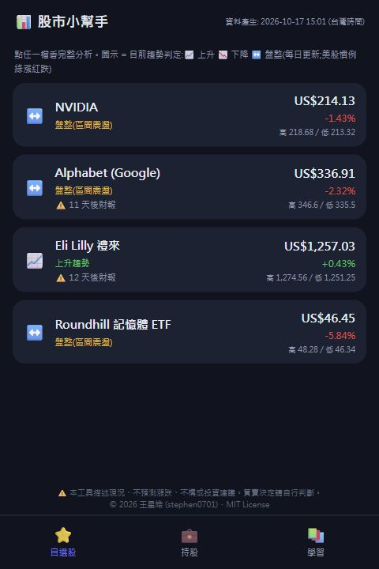
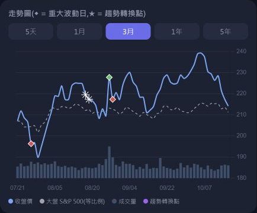
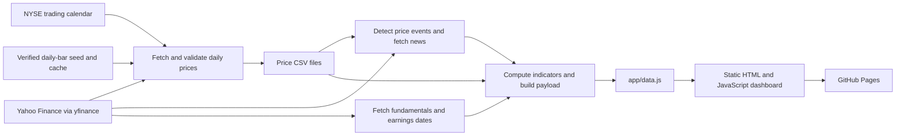

# Stock Trend Analysis

A Traditional Chinese stock dashboard that turns daily market data into an interactive view of price trends, technical indicators, company fundamentals, and news. The project combines a Python data pipeline with a static JavaScript interface and automated GitHub Pages deployment.

[Live demo](https://stephen0701.github.io/stock-trend-analysis/) · [Architecture and methodology](docs/ARCHITECTURE.md) · [Setup and deployment](docs/GITHUB_SETUP.md) · [Validation](docs/VALIDATION.md)

The live demo was checked on **October 17, 2026**. The application interface remains in **Traditional Chinese**; this documentation is in English.

## Project overview

The application brings several kinds of market information into one mobile-oriented interface. It currently tracks **NVDA, GOOG, LLY, and DRAM**, with the **S&P 500 (`^GSPC`)** as its benchmark.

The engineering focus is the complete path from external data to a deployed application: validating daily quotes, handling missing historical values conservatively, computing transparent indicators, producing a browser-ready payload, and deploying only after the pipeline succeeds. The browser needs no application server or API credentials.

## Key features

| Feature | Implemented behavior |
| --- | --- |
| Watchlist and stock details | Latest available daily prices, daily changes, high/low values, trend labels, and earnings countdowns when available. |
| Explainable trend analysis | Moving-average and ADX rules classify upward, downward, or range-bound conditions; historical transitions and time in the current regime are shown. |
| Technical context | Moving averages, benchmark-relative returns, RSI, MACD histogram, Bollinger %B, ADX, annualized volatility, and recent support/resistance ranges. |
| Interactive charts | Chart.js price and volume charts, a rebased S&P 500 comparison, event markers, and five selectable time ranges, subject to available history. |
| Fundamentals and news | Provider-supplied fundamentals, earnings dates, linked headlines, and keyword-based positive/negative/neutral news labels. |
| Local holdings tracker | Multiple purchase lots, average cost, estimated market value, and unrealized gain/loss stored in the browser's `localStorage`. |
| Learning interface | Traditional Chinese explanations, glossary dialogs, and expandable FAQs. |
| Data safeguards | Completed-session checks, retries, same-date verified history recovery, strict price validation, and unavailable/stale-data UI states. |

## Screenshots

These are actual captures of the deployed application on **October 17, 2026**, cropped to the application area. Prices and labels are historical examples, not fixed expected outputs. No personal holdings were used.

**Watchlist:** the four tracked instruments, trend states, price changes, and navigation.



**NVIDIA chart:** the three-month view with price, rebased S&P 500, volume, and event markers. The benchmark line is a comparison series, not the index's absolute price.



## Technical architecture



`run_daily.py` executes the four pipeline stages in order and stops on a nonzero exit code. The frontend reads `window.APP_DATA` from the generated `app/data.js`; Chart.js **4.4.1** is loaded from a CDN. Holdings remain in browser storage and are not submitted to a project backend.

The default provider is Yahoo Finance. A separate Tiingo adapter exists for explicit testing, but it is **not enabled in the daily workflow**, is not an automatic fallback, and has not been verified here against live Tiingo data. See the [architecture guide](docs/ARCHITECTURE.md) for exact rules and failure behavior.

## Run locally

To inspect the saved interface without fetching market data, open [`app/index.html`](app/index.html) in a browser. Alternatively, clone and serve it locally:

```bash
git clone https://github.com/stephen0701/stock-trend-analysis.git
cd stock-trend-analysis
python -m http.server 8000 --directory app
```

Open **http://localhost:8000/**. The committed payload is a saved snapshot and may trigger stale-data warnings; scheduled deployments regenerate their own data. Internet access is needed for the Chart.js CDN, news links, and data refreshes.

To refresh data, use **Python 3.11**, matching the workflow. From the repository root, create an environment outside the checkout:

```bash
python -m venv ../stock-trend-analysis-venv
```

Activate it (`..\stock-trend-analysis-venv\Scripts\activate.bat` in Windows Command Prompt, or `source ../stock-trend-analysis-venv/bin/activate` on macOS/Linux), then run:

```bash
python -m pip install -r requirements.txt
python run_daily.py
```

The Yahoo pipeline requires no API token. Windows users with Python and the dependencies installed can also use `run_daily.bat`. See [setup and deployment](docs/GITHUB_SETUP.md) for PowerShell commands, generated files, and troubleshooting.

## Automation and deployment

The [`daily-update` workflow](.github/workflows/daily-update.yml) runs on pushes to `main`, manual dispatch, and two schedules:

| Cron expression (UTC) | Taiwan time (UTC+8) | Purpose |
| --- | --- | --- |
| `17 22 * * 1-5` | Tuesday–Saturday, 06:17 | Primary update after the US session. |
| `17 2 * * 2-6` | Tuesday–Saturday, 10:17 | A second opportunity for delayed provider data. |

Each run installs the pinned Python dependencies, runs Python and JavaScript regression tests, restores the verified-bar cache, executes the data pipeline, saves available verified bars, and uploads `app/` for GitHub Pages deployment. It **does not commit generated data back to the repository**. A shared concurrency group serializes build and deployment runs. Scheduled start times can be delayed by GitHub; the NYSE calendar determines which completed session the data must match.

## Testing

From the repository root, with Python dependencies installed and Node.js available:

```bash
python -m unittest discover -s tests -v
node tests/test_frontend.cjs
```

The existing tests cover same-session quote repair, corporate-action-aware history recovery, calendar/date requirements, retry behavior, cache persistence, Tiingo parsing, and safe frontend rendering for invalid quotes. The JavaScript test uses Node's built-in modules and requires no `npm install`.

See [validation and its limits](docs/VALIDATION.md) for the verification record. These checks do not establish forecasting accuracy, trading returns, comprehensive browser coverage, or provider availability.

## Repository layout

```text
app/                          Static interface and saved/generated data payload
pipeline/                     Price, event, fundamental, and payload stages
data/raw/                     Saved price CSVs; runtime status and ignored cache
data/processed/               Event/news and fundamental JSON snapshots
data/yahoo_verified_seed.json  Verified historical daily-bar seed
tests/                        Python regressions and JavaScript rendering checks
docs/                         Architecture, setup, validation, and screenshots
.github/workflows/            Scheduled tests, build, and Pages deployment
requirements.txt              Pinned direct Python dependencies
run_daily.py / run_daily.bat   Sequential update entry points
```

## Scope and limitations

Trend states and news labels are deterministic heuristics. The interface also contains rule-based buy/reduce/wait prompts; these have not been validated as a profitable trading strategy. The current application contains no trained forecasting model or order-execution integration.

Market data is daily rather than real time. Missing news or fundamentals can produce empty sections or placeholders, while invalid or stale price responses stop the update pipeline. A failed update leaves the previously deployed site in place; a successful deployment and its generation timestamp alone do not guarantee that every optional provider field is complete. Short listing histories limit available chart ranges and longer moving averages.

Holdings are local to the browser and origin. Clearing browser storage or changing devices can lose those records. The repository does not implement account sync or holdings backup.

## License

Project source is available under the [MIT License](LICENSE). External market data, linked news, and CDN assets remain subject to their providers' terms; the source-code license does not grant rights to those materials.
